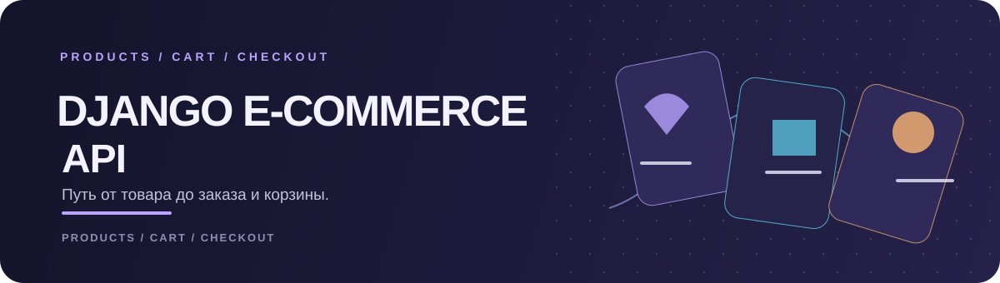
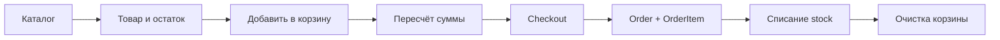

<div align="center">
  
  <br>
  
  
  
  
  <p><strong>От витрины до заказа — короткий путь покупки.</strong></p>
</div>

Этот репозиторий содержит учебный backend для интернет-магазина. Каталог товаров соединён с персональной корзиной и оформлением заказов; данные заказа сохраняются отдельно от содержимого корзины.

## Путь заказа



## Маршруты

| Метод | Путь | Назначение |
|---|---|---|
| `GET/POST` | `/api/categories/` | Список и создание категорий |
| `GET/POST` | `/api/products/` | Каталог и управление товарами |
| `GET` | `/api/cart/my_cart/` | Текущая корзина и её сумма |
| `POST` | `/api/cart/add_item/` | Добавить товар по `product_id` и количеству |
| `POST` | `/api/cart/remove_item/` | Удалить товар из корзины |
| `GET/POST` | `/api/orders/` | Просмотр собственных заказов |
| `POST` | `/api/orders/checkout/` | Создать заказ из корзины |

Каталог доступен для чтения без входа; создание и изменение категорий и товаров требуют аутентификации. Корзина и заказы требуют JWT. Корзина содержит вычисляемые суммы, а позиция заказа сохраняет цену на момент оформления.

## Структура

```text
accounts/   регистрационный сериализатор и view
products/   категории, товары и остатки
cart/       личная корзина и позиции
orders/     заказ, строки заказа и checkout
config/     корневые маршруты и настройки
```

Модуль `accounts` содержит регистрацию и JWT-маршруты, но пока не подключён в `config/urls.py`; отдельного публичного маршрута входа в текущей конфигурации нет.

## Быстрый запуск

```bash
python -m venv .venv
```

```powershell
.\.venv\Scripts\Activate.ps1
pip install -r requirements.txt
python manage.py migrate
python manage.py runserver
```

API будет доступен по адресу `http://127.0.0.1:8000/api/`. Проект использует SQLite для локального запуска.

## Технологии

`Python` · `Django` · `Django REST Framework` · `SimpleJWT` · `SQLite`
